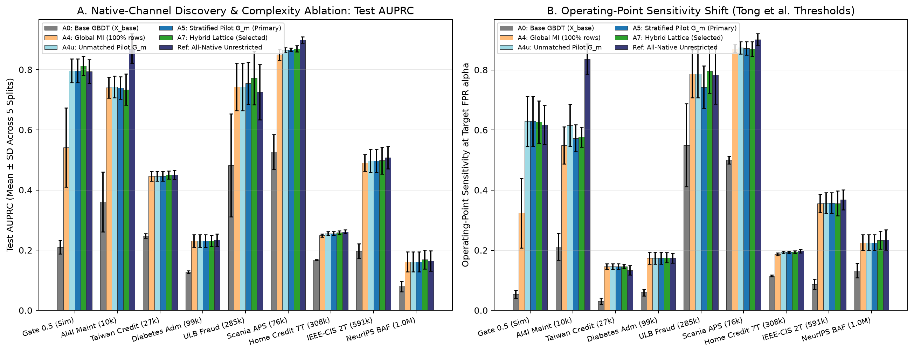

# CREDO & CREDO-Bench (`imboreceipt`)

**CREDO: Budgeted Channel Discovery and Selective Feature Acquisition for Imbalanced Prediction**

[](tests/)
[](pyproject.toml)
[](LICENSE)
[](manuscript/main.pdf)
[](docs/CHAIRMAN_EXECUTIVE_BRIEF_1PAGE.pdf)

> **Author:** Wayne A. Satz, MD (Department of Emergency Medicine, Lewis Katz School of Medicine at Temple University)  
> **Full Paper:** [`manuscript/main.pdf`](manuscript/main.pdf) | **1-Page Thought-Experiment Brief:** [`docs/CHAIRMAN_EXECUTIVE_BRIEF_1PAGE.pdf`](docs/CHAIRMAN_EXECUTIVE_BRIEF_1PAGE.pdf) | **Interactive Project Page:** [`docs/index.html`](docs/index.html)

---

## Overview

Imbalanced prediction in clinical screening, industrial monitoring, and fraud detection ($\pi = \mathbb{P}(Y=1) \in [10^{-3}, 0.20]$) is routinely treated as an algorithmic resampling problem on a fixed baseline feature table $X_{\text{base}}$. When $X_{\text{base}}$ lacks conditional resolution among high-risk arrivals, however, improving precision requires **identifying** and **selectively acquiring** additional Stage-2 feature channels under explicit discovery and deployment budgets.

**CREDO** (*Calibrated Receipt-Repaired Evidence Discovery and Orchestration*) evaluates both its methodological gains and its exact failure boundaries across **CREDO-Bench**: **10 fixed-table benchmarks** (`50` splits), **9 multi-channel cohorts** ($N = 10,000$ to $1,000,000$; `45` native-only splits plus `40` separate baseline-echo stress runs), and **7 adversarial failure-mode simulations**:

1. **Stabilized Fixed-Table Baselines & Uncertainty Accounting (`Lemma 1`):** Under Newton-stabilized `LightGBM` (`max_delta_step=1.0`) with natural-prevalence Platt calibration, `SMOTE`, `ADASYN`, copulas, `EasyEnsemble`, and `RUSBoost` yield **0 out of 10 statistically detectable AUPRC gains** ($p_{\text{NB}} \ge 0.068$, Holm $p \ge 0.88$), while small test minority counts ($n_+ \in [5, 12]$) carry wide Binomial Wilson $95\%$ sensitivity half-widths ($\pm 0.183$ to $\pm 0.221$).
2. **Horvitz–Thompson Stratified-Pilot Conditional Log-Likelihood Gain (`Lemma 2`, $\hat{G}_m$):** Sampling $100\%$ of training cases plus a known-probability baseline-score-stratified control subcohort ($\pi_{0,b} = n_{0,b}/N_{0,b} > 0$, exact HT weights summing to $N_0$) and scoring candidate channels via offset-anchored GBDT conditional log-likelihood gain $\hat{G}_m$ over $[X_{\text{base}}, Z_m]$ improves significantly over $X_{\text{base}}$ on **all 9 / 9 native cohorts** (Holm $p \le 0.018$ for both AUPRC and Tong et al. $(\alpha,\delta=0.05)$-certified Neyman–Pearson sensitivity), matches $100\%$-row conditional discovery within `0.0009` AUPRC on `8/9` cohorts while saving **44.0%–98.4%** of discovery channel accesses, and achieves **0.0% false selection of injected baseline echoes** (`40/40` stress runs vs. `30%–50%` under marginal mutual information on large multi-table cohorts).
3. **Conformal Singleton Precision & Six-Policy Runtime Routing (`Proposition 1`):** Because class-conditional Mondrian coverage bounds negative false alarms only by $\alpha_0$, positive `{1}` singletons exhibit low realized precision (`3.8%–38.8%` PPV across all 9 cohorts). Upper-tail conformal acquisition outperforms corrected **Literal Conformal `{0,1}`** ambiguity routing on **9 / 9 cohorts** (`83.4%–99.4%` raw AUPRC retention; `76.3%–98.4%` incremental gain retention; `24.3%–79.0%` simulated Stage-2 accesses saved), while reducing closely to **Top-Risk-$K$** ($p_2 \ge 0.215$) whenever Stage-1 risk stays below $q_{\text{target}}$—and yielding predictably to **VOI-$K$** when top-risk pockets carry irreducible ambiguity (`Simulation 6`).

---

## Headline Empirical Results

### 1. Fixed-Table Benchmark Suite (`10 Datasets × 5 Splits = 50 Runs`)


---

### 2. Native-Channel Discovery & Complexity Ablation (`9 Cohorts × 5 Splits = 45 Native Runs + 40 Proxy Stress Runs`)

Primary **Arm A5** (`Stratified-Pilot` $\hat{G}_m$ + **Single Calibrated GBDT**, zero synthetic proxies in Panel A) captures virtually all predictive lift without requiring multi-branch ensemble complexity, recovering **96.3%–103.9%** of an unrestricted **All-Native-Channels GBDT** on `8/9` cohorts:

| Cohort (Provenance) | Pilot Used | A0: Base ($X_{\text{base}}$) | A4: Global MI (`100%`) | A4u: Unm Pilot $\hat{G}_m$ | **A5: Strat Pilot $\hat{G}_m$ (Primary)** | A7: Hybrid Lattice | Ref: All-Native GBDT | Holm $p$ (A5 vs A0) |
| :--- | :---: | :---: | :---: | :---: | :---: | :---: | :---: | :---: |
| **Gate 0.5** (`Sim.`) | `20.5%` | `0.2104` | `0.5415` | `0.7964` | **`0.7964`** | `0.8129` | `0.7940` | **`0.00002`** |
| **UCI AI4I** (`Syn. Phys.`) | `16.9%` | `0.3606` | `0.7404` | `0.7428` | **`0.7395`** | `0.7339` | `0.8702` | **`0.00299`** |
| **UCI Taiwan** (`Obs.`) | `56.0%` | `0.2474` | `0.4461` | `0.4461` | **`0.4461`** | `0.4505` | `0.4506` | **`0.00025`** |
| **UCI Diabetes Adm.** (`Obs.`, `99.3k`) | `34.2%` | `0.1272` | `0.2307` | `0.2307` | **`0.2307`** | `0.2307` | `0.2338` | **`0.00233`** |
| **ULB Credit PCA** (`Obs.`, `285k`) | `1.2%` | `0.4821` | `0.7428` | `0.7428` | **`0.7541`** | `0.7723` | `0.7251` | **`0.01775`** |
| **Scania APS** (`Obs.`, `76k`) | `9.0%` | `0.5260` | `0.8499` | `0.8655` | **`0.8662`** | `0.8699` | `0.8991` | **`0.00233`** |
| **Home Credit 7T** (`Obs.`, `308k`) | `40.4%` | `0.1678` | `0.2489` | `0.2557` | **`0.2557`** | `0.2585` | `0.2615` | **`0.00006`** |
| **IEEE-CIS 2T** (`Obs.`, `591k`) | `15.1%` | `0.1974` | `0.4905` | `0.4974` | **`0.4974`** | `0.4983` | `0.5078` | **`0.00123`** |
| **NeurIPS BAF** (`Priv. Syn.`, `1.0M`) | `4.1%` | `0.0795` | `0.1613` | `0.1613` | **`0.1613`** | `0.1688` | `0.1643` | **`0.00299`** |

*Separate Injected Baseline-Echo Stress Test (`40` runs):* On the three large multi-table cohorts (`Home Credit`, `IEEE-CIS`, `NeurIPS BAF`), marginal `Global MI`, `Unmatched CC MI`, and `Pilot MI` select baseline-echo proxies on **30%–50%** of budget slots (`0.2454` vs `0.2557` on `Home Credit`, Holm $p=0.0168$; `0.1122` vs `0.1613` on `BAF`, $p_{\text{NB}}=0.0111$), whereas **Stratified-Pilot $\hat{G}_m$ (`A5`) records `0.0%` false proxy selection across all `40/40` runs**.



---

### 3. Equal-Budget Runtime Selective Acquisition Across Six Policies (`45 Native Runs`)

| Cohort | `{1}` PPV | S2 Saved | Stage-1 Only | Random-$K$ | Literal `{0,1}` | Uncertainty-$K$ | VOI-$K$ | Top-Risk-$K$ | **CREDO Upper-Tail** | `100%` S2 | Holm $p$ (vs `{0,1}`) | $p_2$ (vs TopK) |
| :--- | :---: | :---: | :---: | :---: | :---: | :---: | :---: | :---: | :---: | :---: | :---: | :---: |
| **Gate 0.5** | `15.4%` | `62.9%` | `0.2104` | `0.4923` | `0.4620` | `0.6631` | `0.6510` | `0.6631` | **`0.6631`** | `0.7964` | **`0.00190`** | `1.000` |
| **UCI AI4I** | `12.4%` | `77.1%` | `0.3606` | `0.4343` | `0.4424` | `0.6534` | `0.6323` | `0.6534` | `0.6517` | `0.7395` | `0.05323` | `0.671` |
| **UCI Taiwan** | `26.4%` | `34.6%` | `0.2474` | `0.3937` | `0.3917` | `0.4179` | `0.4073` | `0.4179` | **`0.4179`** | `0.4461` | `0.13952` | `1.000` |
| **UCI Diabetes Adm.** | `12.8%` | `24.3%` | `0.1272` | `0.2095` | `0.2071` | `0.2146` | **`0.2169`** | `0.2146` | `0.2146` | `0.2307` | `0.13952` | `1.000` |
| **ULB Credit** | `10.1%` | `79.0%` | `0.4821` | `0.5347` | `0.5415` | **`0.7510`** | `0.7184` | **`0.7510`** | `0.7357` | `0.7541` | `0.13952` | `0.215` |
| **Scania APS** | `38.8%` | `78.6%` | `0.5260` | `0.6229` | `0.6285` | **`0.8610`** | `0.8262` | **`0.8610`** | `0.8609` | `0.8662` | **`0.00214`** | `0.551` |
| **Home Credit** | `16.3%` | `41.4%` | `0.1678` | `0.2247` | `0.2028` | `0.2472` | `0.2432` | `0.2472` | **`0.2472`** | `0.2557` | **`0.00214`** | `1.000` |
| **IEEE-CIS** | `10.6%` | `62.0%` | `0.1974` | `0.3317` | `0.2297` | `0.4738` | `0.4331` | `0.4738` | **`0.4739`** | `0.4974` | **`0.00059`** | `0.358` |
| **NeurIPS BAF** | `3.8%` | `61.9%` | `0.0795` | `0.1108` | `0.0844` | `0.1568` | `0.1425` | `0.1568` | **`0.1568`** | `0.1613` | **`0.00500`** | `1.000` |


---

## Repository Architecture

```text
imboreceipt/
├── src/imboreceipt/
│   ├── core/        # SHA-256 4-way splits (grouped & forward chronological), Nadeau-Bengio & Holm (1979) stats
│   ├── contract/    # Operational decision contract, exact Binomial Wilson 95% intervals, Tong et al. NP checks
│   ├── receipt/     # Outcome-independent eligibility auditing, empirical receipt discrepancy (ADI)
│   ├── frontier/    # Exploratory bottleneck diagnostics, stabilized calibrated GBDT, resampling/ensemble suite
│   ├── discover/    # Strict forward expanding-block CV, HT stratified case-cohort pilot, offset-anchored G_m
│   ├── lattice/     # Calibrated hybrid lattice & 6 equal-budget runtime routing policies (conformal, TopK, Unc, VOI)
│   └── bench/       # Native-only vs. proxy-stress benchmark loaders, 7 adversarial simulations, campaign runner
├── results/reconstructed/ # Full SHA-256 manifests, summary JSONs, per-seed receipts, and publication figures
├── tests/           # 31/31 unit, strict chronology, HT weight, tied-score NP, and routing regression tests
├── manuscript/      # LaTeX source (main.tex, references.bib), compiled PDF (main.pdf), and figures
└── docs/            # 1-Page Executive Brief (CHAIRMAN_EXECUTIVE_BRIEF_1PAGE.pdf) & GitHub Pages site (index.html)
```

---

## Quickstart & Reproducibility

```bash
# 1. Create virtual environment and install package with dev/test dependencies
python3 -m venv .venv
source .venv/bin/activate
pip install -e ".[dev]"

# 2. Run the full 31-test unit, chronology, HT weight, and counterexample regression suite
pytest -q

# 3. Reproduce the full reconstructed benchmark campaign & adversarial simulation suite
imboreceipt bench-reconstructed --out results/reconstructed --n-seeds 5 --uncapped
```

---

## Citation

```bibtex
@misc{satz2026credo,
  author       = {Satz, Wayne A.},
  title        = {{CREDO}: Budgeted Channel Discovery and Selective Feature Acquisition for Imbalanced Prediction},
  year         = {2026},
  howpublished = {\url{https://github.com/deesatzed/imboreceipt}}
}
```

## License

Released under the **MIT License** (see [`LICENSE`](LICENSE)).
