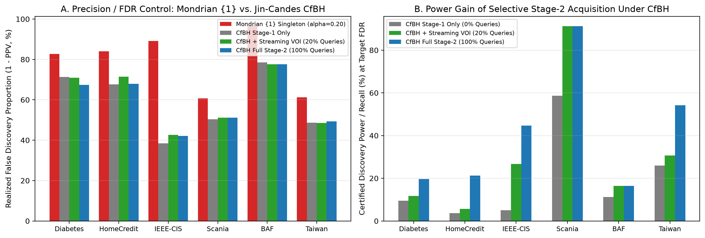

# `imboreceipt` — Two-Phase Stratified Pilot Discovery & Streaming Selective Feature Acquisition

**Two-Phase Stratified Pilot Discovery and Streaming Selective Feature Acquisition for Cost-Constrained Prediction**

[](tests/)
[](pyproject.toml)
[](LICENSE)
[](manuscript/main.pdf)
[](docs/CHAIRMAN_EXECUTIVE_BRIEF_1PAGE.pdf)

> **Author:** Wayne A. Satz, MD (Department of Emergency Medicine, Lewis Katz School of Medicine at Temple University)  
> **Full Preprint:** [`manuscript/main.pdf`](manuscript/main.pdf) | **1-Page Executive Walkthrough:** [`docs/CHAIRMAN_EXECUTIVE_BRIEF_1PAGE.pdf`](docs/CHAIRMAN_EXECUTIVE_BRIEF_1PAGE.pdf) | **Interactive Project Page:** [`docs/index.html`](docs/index.html)

---

## Overview

Predicting rare adverse outcomes in hospital discharge care coordination, consumer lending, industrial fleet maintenance, and real-time payment/onboarding fraud ($\pi = \mathbb{P}(Y=1) \in [0.01, 0.22]$) frequently hits severe conditional risk overlap on routine baseline covariates $X_{\text{base}}$. Rather than resampling $X_{\text{base}}$—where our 20-split Schuirmann TOST & DerSimonian–Laird meta-analysis across 10 fixed-table benchmarks bounds HPO-tuned calibrated SMOTE to `-0.0040` AUPRC (`95% CI [-0.0097, +0.0017]`) relative to stabilized calibrated LightGBM—resolving baseline overlap under explicit measurement budgets poses a **two-stage statistical design problem**:

1. **Stage A — Constrained Neyman Two-Phase Pilot Discovery (`Theorem 1`, `Proposition 1`):** Given $M$ candidate Stage-2 feature channels $Z_1, \dots, Z_M$ with acquisition costs $\sum_{m \in \mathcal{S}} c_m \le B$, we draw a single Phase-2 pilot $\mathcal{P} \subset \mathcal{D}_{\text{train}}$ of exact target fraction $\rho \in (0, 1]$ (even when $\pi > \rho$) via water-filling constrained Neyman allocation over joint Phase-1 $(Y, \text{score\_bin})$ strata. On $\mathcal{P}$, we estimate sequential forward **untruncated** Horvitz–Thompson conditional log-likelihood gain $\hat{G}_{m \mid \mathcal{S}_{t-1}}$ equipped with an exact two-phase variance decomposition ($V_{\text{I}} + V_{\text{II}}$) and Holm step-down lower-confidence-bound (LCB) stopping.
2. **Stage B — Streaming Value-of-Information Routing & Conformal FDR Selection (`CfBH`):** At deployment, arrivals are routed individually in real time using thresholds calibrated strictly on $\mathcal{D}_{\text{cal}}$ across $q \in [0\%, 100\%]$ or via the parameter-free Bayes stopping rule $\widehat{\operatorname{VOI}}_{\mathcal{K}}(x) > c_{\text{query}}$. For high-precision positive alert lists at target $\text{FDR} = 1 - q_{\text{target}}$, Jin & Candès (2023) smoothed conformal Benjamini–Hochberg selection (`CfBH`) replaces unverified Mondrian `{1}` singletons (`60.7%–96.5%` false discoveries under rarity).

---

## Headline Empirical Results (`R = 20` Splits per Cohort; `160` Multi-Channel Splits + `200` Fixed-Table Runs)

### 1. Stage-A Fine-Grained Native Discovery (`M = 15–26` Channels) & Stress Testing (`M = 25–36`)

Across six public multi-channel cohorts (`UCI Diabetes Discharge`, `Home Credit 7-Table`, `IEEE-CIS Fraud`, `Scania APS Trucks`, `NeurIPS BAF 1M`, `UCI Taiwan Credit`), a **15% Neyman pilot** cuts Phase-2 row-channel accesses by **85%**, retains **98.3%** of full-cohort (`100%`-row) Stage-2 AUPRC (**95.5%** of incremental lift over $X_{\text{base}}$; pooled random-effects $\Delta_{15-100} = -0.0059$, `95% CI [-0.0089, -0.0029]`), matches or exceeds `100%` discovery on operational Net Benefit on **4 / 6 cohorts** ($p_{\text{NI,NB}} \le 0.012$), beats `15%` simple random pilots by **+0.0217 to +0.0689 AUPRC** on low-prevalence cohorts, and records **0.0% pure-noise null, 0.0% duplicate Stage-2 twin, and 0.0% baseline echo selection across all 120 / 120 stress splits**:

| Cohort ($N$, $M$ Native, $\pi$) | Base $X_{\text{base}}$ | Global MI (`100%`) | SRS Pilot (`15%`) | **Neyman Seq-CMI (`15%`)** | Full Seq-CMI (`100%`) | $\Delta_{15-100}$ Net Benefit ($p_{\text{NI,NB}}$) | Stress Pool Spurious (`null/twin/echo%`) |
| :--- | :---: | :---: | :---: | :---: | :---: | :---: | :---: |
| **UCI Diabetes Discharge** (`99k`, `M=16`, `11.4%`) | `0.1782` | `0.1834` | `0.2213` | **`0.2214`** | `0.2249` | **`+0.84` (`0.0116`)** | **`0 / 0 / 0%`** |
| **Home Credit 7-Table** (`140k`, `M=26`, `8.1%`) | `0.1606` | `0.1788` | `0.2270` | **`0.2324`** | `0.2383` | **`+0.13` (`0.0084`)** | **`0 / 0 / 0%`** |
| **IEEE-CIS Stream** (`591k`, `M=25`, `3.7%`) | `0.2059` | `0.3703` | `0.4697` | **`0.5091`** | `0.5089` | `-0.04` (`0.1386`) | **`0 / 0 / 0%`** |
| **Scania APS Fleet** (`76k`, `M=22`, `1.8%`) | `0.5233` | `0.7837` | `0.7826` | **`0.8515`** | `0.8636` | **`+0.19` (`<0.0001`)** | **`0 / 0 / 0%`** |
| **NeurIPS BAF Stream** (`1.0M`, `M=18`, `1.1%`) | `0.0715` | `0.1070` | `0.0812` | **`0.1029`** | `0.1150` | **`+0.07` (`0.0006`)** | **`0 / 0 / 0%`** |
| **UCI Taiwan Credit** (`30k`, `M=15`, `22.1%`) | `0.4084` | `0.5504` | `0.5436` | **`0.5442`** | `0.5542` | `-0.67` (`0.5474`) | **`0 / 0 / 0%`** |


---

### 2. Stage-B Streaming VOI Budget Frontiers & Conformal FDR Selection (`CfBH`)

| Cohort ($\tau^*$, Target FDR) | Stage-1 NB (`0%`) | Top-Risk NB (`20%`) | **Streaming VOI NB (`20%`)** | **Autonomous $\widehat{\operatorname{VOI}}_{\mathcal{K}} > c_q$ (Rate)** | Mondrian `{1}` FDP | **`CfBH` + VOI-20% FDP (Recall)** |
| :--- | :---: | :---: | :---: | :---: | :---: | :---: |
| **UCI Diabetes** (`0.111`, `70%`) | `18.75` | `17.93` | **`20.86`** | **`22.35`** (`55.5%`) | `82.7%` | **`71.0%` (`11.8%`)** |
| **Home Credit** (`0.077`, `68%`) | `22.47` | `22.53` | **`25.37`** | **`27.70`** (`61.6%`) | `84.1%` | **`71.4%` (`5.6%`)** |
| **IEEE-CIS** (`0.038`, `40%`) | `15.70` | `17.89` | **`18.70`** | **`19.83`** (`33.7%`) | `89.1%` | **`42.6%` (`26.7%`)** |
| **Scania APS** (`0.020`, `50%`) | `15.92` | `16.23` | `14.98` | **`16.25`** (**`7.2%`**) | `60.7%` | **`51.1%` (`91.3%`)** |
| **NeurIPS BAF** (`0.032`, `75%`) | `2.28` | `3.13` | `2.44` | **`3.08`** (**`12.8%`**) | `96.5%` | **`77.5%` (`16.4%`)** |
| **UCI Taiwan** (`0.167`, `50%`) | `87.26` | `86.10` | **`93.30`** | **`97.93`** (`72.8%`) | `61.3%` | **`48.5%` (`30.6%`)** |




---

## Repository Architecture

```text
imboreceipt/
├── src/imboreceipt/
│   ├── core/        # SHA-256 4-way splits (grouped & forward chronological), Nadeau-Bengio, TOST & DL meta-analysis
│   ├── contract/    # Operational decision contract (C_FP, C_FN, q_target, c_query), Wilson CIs, NP checks
│   ├── frontier/    # Newton-stabilized Platt-calibrated LightGBM, HPO-tuned SMOTE & resampling baseline suite
│   ├── discover/    # Water-filling Neyman two-phase pilot, sequential untruncated G_{m|S}, V_I+V_II SE, CPI/LOCO/CRT
│   ├── lattice/     # Calibration-only streaming VOI/uncertainty/Mondrian routers & Jin-Candes CfBH FDR selection
│   └── bench/       # Fine-grained multi-channel cohorts (M=15..26 native; M=25..36 stress), Monte Carlo & campaign
├── results/two_phase/ # 160 per-split JSON checkpoints, theory_simulations.json, TOST supplement, and figures
├── tests/           # 37/37 unit, two-phase variance, Neyman water-filling, streaming calibration & CfBH tests
├── manuscript/      # Sealed LaTeX source (main.tex, references.bib), compiled PDF (main.pdf), and vector figures
└── docs/            # 1-Page Executive Brief (CHAIRMAN_EXECUTIVE_BRIEF_1PAGE.pdf) & GitHub Pages site (index.html)
```

---

## Quickstart & Reproducibility

```bash
# 1. Create virtual environment and install package with dev/test dependencies
python3 -m venv .venv
source .venv/bin/activate
pip install -e ".[dev]"

# 2. Run the full 37-test unit and statistical verification suite + Ruff linter
pytest -q
ruff check src tests scripts

# 3. Reproduce the full R=20 two-phase discovery, stress-pool, streaming VOI/CfBH, and TOST campaign
imboreceipt bench-two-phase --out results/two_phase --n-splits 20
```

---

## Citation

```bibtex
@misc{satz2026twophase,
  author       = {Satz, Wayne A.},
  title        = {Two-Phase Stratified Pilot Discovery and Streaming Selective Feature Acquisition for Cost-Constrained Prediction},
  year         = {2026},
  howpublished = {\url{https://github.com/deesatzed/imboreceipt}}
}
```

## License

Released under the **MIT License** (see [`LICENSE`](LICENSE)).
