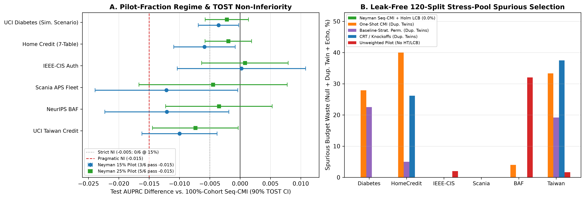
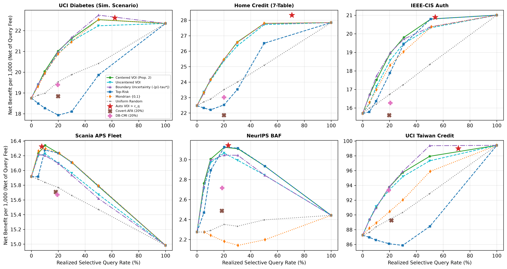
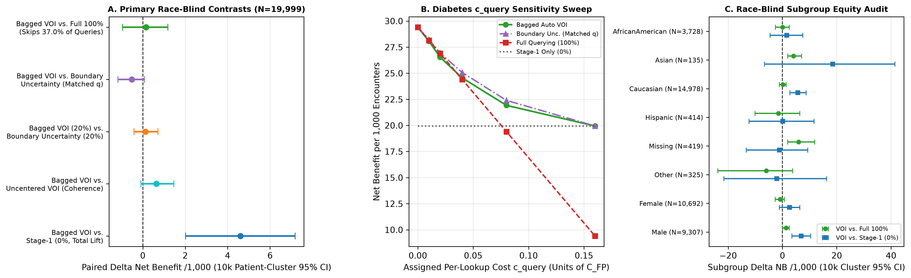

# `imboreceipt` — Budgeted Feature-Channel Discovery from Two-Phase Stratified Pilots (`v2.2.0`)

**Budgeted Feature-Channel Discovery from Two-Phase Stratified Pilots, with Retrospective Evaluation of Cost-Aware Selective Querying**

[](tests/)
[](pyproject.toml)
[](LICENSE)
[](https://doi.org/10.20944/preprints202611.2517.v1)

> **Author:** Wayne A. Satz, MD (Department of Emergency Medicine, Lewis Katz School of Medicine at Temple University; `satzwa@temple.edu`)  
> **Preprints.org Version 1 DOI:** [`10.20944/preprints202611.2517.v1`](https://doi.org/10.20944/preprints202611.2517.v1) | **Manuscript (`v2.2.0`):** [`manuscript/main.pdf`](manuscript/main.pdf) | **Seed Manifest:** [`SEED_MANIFEST.md`](SEED_MANIFEST.md) | **Pinned Lockfile:** [`requirements-lock.txt`](requirements-lock.txt) | **Citation Metadata:** [`CITATION.cff`](CITATION.cff)

---

## Overview

Rare-event screening across clinical risk assessment, consumer lending, industrial fleet telemetry, and fraud detection ($\pi = \mathbb{P}(Y=1) \in [0.01, 0.22]$) frequently encounters conditional risk overlap on routine baseline covariates $X_{\text{base}}$. Rather than resampling $X_{\text{base}}$—where our 20-split Schuirmann TOST and DerSimonian–Laird meta-analysis across 10 fixed-table benchmarks bounds HPO-tuned calibrated SMOTE to `-0.0040` AUPRC (`95% CI [-0.0097, +0.0017]`) relative to stabilized calibrated LightGBM—resolving baseline overlap under explicit measurement budgets centers on **Stage-A two-phase pilot channel discovery**, paired with a retrospective evaluation of **Stage-B cost-aware selective querying**:

1. **Stage A (Primary Contribution) — Constrained Neyman Two-Phase Pilot Discovery (`Assumption 1`, `Theorem 1`, `Proposition 1`):** Given $M$ candidate Stage-2 feature channels $Z_1, \dots, Z_M$ with acquisition budget $\sum_{m \in \mathcal{S}} c_m \le B$, we draw a Phase-2 pilot $\mathcal{P} \subset \mathcal{D}_{\text{train}}$ of exact target fraction $\rho \in (0, 1]$ via water-filling constrained Neyman allocation over joint Phase-1 $(Y, \text{score\_bin})$ strata. On a disjoint `50/50` split-pilot $\mathcal{P} = \mathcal{P}_{\text{fit}} \sqcup \mathcal{P}_{\text{eval}}$ (`discover_sequential_split_pilot`), design-based two-phase variance ($V_{\text{I}} + V_{\text{II}}$) and sequential Holm stopping hold conditional on $\mathcal{P}_{\text{fit}}$ under signal separation, while `4`-fold cross-fitting (`discover_sequential_conditional_gain`) provides a higher-power full-pilot heuristic.
2. **Stage B (Retrospective Evaluation) — Fee-Aware Selective VOI Querying & Conformal Selection (`Proposition 2`, `Remarks 1–2`):** Enforcing a unique mean-preserving logit offset $\mu^*(p_1)$ guarantees coherent $\widehat{\operatorname{VOI}}_{\mathcal{K}}(x) \ge 0$ without post-hoc clipping. Across six full unsampled canonical holdouts (`N = 30k–1.0M`), we evaluate autonomous stopping $\widehat{\operatorname{VOI}}_{\mathcal{K}}(x) > c_{\text{query}}$ directly against **100% Full Stage-2 Querying** and **Boundary Uncertainty (`-|p1 - tau*|`)** across $c_{\text{query}} \in \{0.00, 0.01, 0.04, 0.08, 0.16\}$, alongside `CovertGreedyCMIAFA` (including `DB-CMI` and proportional-cost fee accounting) and `R = 100` shift replications comparing `CfBH`, Jin–Candès Weighted Conformalized Selection (`WCS`), and local burn-in recalibration (`n = 2,500`).

---

## Key Empirical Findings (`v2.2.0`)

- **Monte Carlo Audit (`results/two_phase/v2_2_blocks/block1_v2_2_weak_signal_and_twins.json`):**
  - On disjoint `50/50` split-pilots, sequential discovery achieves **`98.1%`** (`[97.0%, 98.9%]`) adaptive 95% CI coverage under strong signal (`1.0%` null FWER) and **`95.6%`** (`[94.1%, 96.8%]`) near the Holm detection boundary (`0.2%` weak-signal FWER; `0.0%` under two competing weak signals), whereas the `4`-fold CV heuristic trades lower CI coverage (**`84.7%`**) for substantially higher finite-sample Step-1/Step-2 power (`92.0%` vs. `59.0%` on weak signals; `0.4%–1.0%` null FWER).
  - Constrained Neyman allocation cuts pilot gain RMSE by **`41.7%–48.9%`** vs. SRS and **`22.8%–29.1%`** vs. balanced case-control (`BCC`), reaching **`57.7%–68.4%`** vs. SRS and **`41.1%–55.5%`** vs. `BCC` with a Breslow–Cain prior-odds offset.
  - Distinguishes 1-column asymmetric twins (where greedy GBDT root concentration allows full-pool `cpi_pilot` to achieve `0.5%` twin waste vs. `100.0%` for marginal baseline-stratified permutation) from multi-column twin channels (`99.0%` twin waste in `cpi_pilot` via off-manifold permutation vs. `0.0%` in sequential forward discovery on leak-free cohorts).
- **Regime-Specific Native Frontiers & Full 120-Split Leak-Free Stress Campaign (`block2_v2_2_full_120split_leakfree_stress.json`):**
  - At $\rho = 15\%$ (`85%` fewer Phase-2 row accesses), Neyman discovery retains `98.3%` of grand-mean (`97.0%` mean-of-ratios) full-cohort AUPRC, passing pragmatic $\Delta_{\text{NI}} = 0.015$ TOST on **`3/6`** cohorts (**`0/6`** at strict `0.005`), rising to **`5/6`** at $\rho = 25\%$ and **`6/6`** at $\rho = 50\%$.
  - Across **all `120/120` leak-free `train_idx`-standardized stress splits** (`20` splits $\times$ `6` cohorts), `Neyman Seq-CMI + Holm` records **`0.0%` null, twin, and echo waste** (`120/120` exact agreement with Step-1 lazy screen disabled) and agrees with cached `20`-split means within split SE on every cohort (`NeurIPS BAF`: `0.1031` vs. `0.1022`; `UCI Taiwan`: `0.5442` vs. `0.5440`), while avoiding the `5.0%–40.0%` twin budget waste of one-shot CMI and `cpi_pilot` (which match or exceed downstream AUPRC on `4/6` cohorts when budget suffices) and the twin cancellation of Chamma residualized CPI and LOCO.
- **Stage-B Selective Querying (`block3`) & Simulated Acquisition Scenario on Race-Blind `UCI Diabetes` (`block5`):**
  - At matched query rate $q$, `Centered VOI` matches `Boundary Uncertainty (-|p1 - tau*|)` on `5/6` canonical holdouts and outperforms it on heteroscedastic `IEEE-CIS` (`+0.66/1,000`, `95% CI [+0.24, +1.06]`), while providing calibrated fee-aware stopping $\widehat{\operatorname{VOI}}_{\mathcal{K}}(x) > c_{\text{query}}$ that matches `100%` querying on `4/6` cohorts at $c_{\text{query}} = 0.04$ (`28%–43%` queries skipped) and beats `100%` querying across **all `6/6` cohorts** (`+2.46` to `+14.54/1,000`) at $c_{\text{query}} = 0.16$.
  - In the post-hoc simulated acquisition scenario on race-blind `UCI Diabetes 130-US` (`N_test = 19,999` outer split; `N_test = 14,909` canonical split), single-draw `Bagged VOI` matches `100%` Stage-2 querying (`+0.15/1,000`, `95% CI [-0.96, +1.18]`; canonical `+0.75 [-0.82, +2.16]`) while skipping **`37.0%`** of prior-utilization lookups (`6.74%` patient-cluster bootstrap 95% upper bound on skipped-case action flips).







---

## Quickstart & Reproducibility

```bash
# 1. Create virtual environment and install pinned dependencies
python3 -m venv .venv
source .venv/bin/activate
pip install -r requirements-lock.txt
pip install -e ".[dev]"

# 2. Run the full 53-test unit, leak-isolation, WCS, DB-CMI, and twin-geometry suite + Ruff linter
pytest -q
ruff check src tests scripts/run_paper1_v2_2_remediation.py scripts/plot_paper1_v2_2_figures.py

# 3. Reproduce the Paper 1 v2.2.0 5-block verification suite and 300-DPI publication figures
python scripts/run_paper1_v2_2_remediation.py
python scripts/plot_paper1_v2_2_figures.py
```

---

## Citation

```bibtex
@article{satz2026twophase,
  author  = {Satz, Wayne A.},
  title   = {Budgeted Feature-Channel Discovery from Two-Phase Stratified Pilots, with Retrospective Evaluation of Cost-Aware Selective Querying},
  journal = {Preprints.org},
  year    = {2026},
  doi     = {10.20944/preprints202611.2517.v1},
  url     = {https://github.com/deesatzed/imboreceipt}
}
```

## License

Released under the **MIT License** (see [`LICENSE`](LICENSE)).
