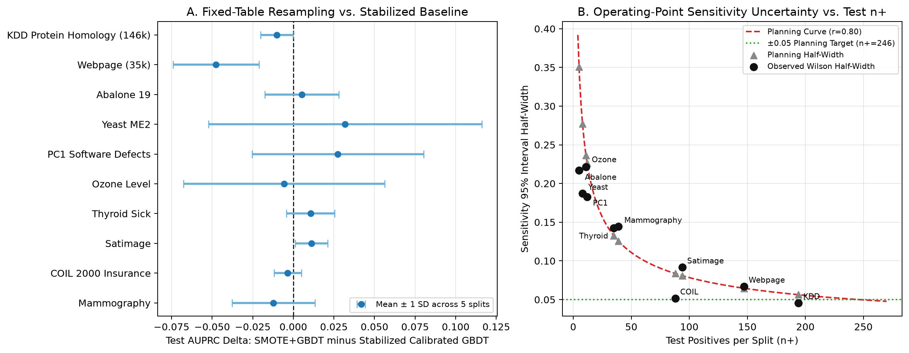
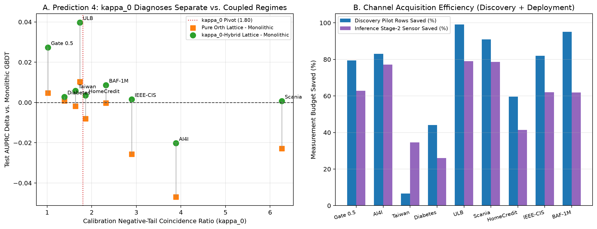

# CREDO & CREDO-Bench (`imboreceipt`)

**Information Bottlenecks in Rare-Event Screening: Fixed-Table Decoder Saturation, Score-Matched Case-Cohort Channel Discovery, and Evidence-Deficit Conformal Foveation**

[](tests/)
[](pyproject.toml)
[](LICENSE)
[](manuscript/main.pdf)
[](docs/CHAIRMAN_EXECUTIVE_BRIEF_1PAGE.pdf)

> **Author:** Wayne A. Satz, MD (Department of Emergency Medicine, Lewis Katz School of Medicine at Temple University)  
> **Full Paper:** [`manuscript/main.pdf`](manuscript/main.pdf) | **1-Page Thought-Experiment Brief:** [`docs/CHAIRMAN_EXECUTIVE_BRIEF_1PAGE.pdf`](docs/CHAIRMAN_EXECUTIVE_BRIEF_1PAGE.pdf) | **Interactive Project Page:** [`docs/index.html`](docs/index.html)

---

## Overview: Three Intuitive Predicates for Rare-Event Screening

Rare-event prediction under severe class imbalance ($\pi = \mathbb{P}(Y=1) \in [10^{-3}, 10^{-1}]$) is routinely treated as an **algorithmic decoding problem**—applying `SMOTE`, `ADASYN`, `EasyEnsemble`, `RUSBoost`, or cost-sensitive reweighting to a fixed baseline table $X_{\text{base}}$. Across **95 leak-free four-way split evaluations** spanning **10 canonical fixed-table benchmarks** ($N = 1,109$ to $145,751$) and **9 multi-channel relational cohorts** ($N = 10,000$ to $1,000,000$), **CREDO** (*Calibrated Receipt-Repaired Evidence Discovery and Orchestration*) reframes rare-event screening around three statistical predicates:

1. **Predicate 1 — Define the Latent-Space Information Gap ($D_q(x) > 0$):** When baseline covariates $X_{\text{base}}$ assign identical risk $\eta_{\text{base}}(x) < q_{\text{target}}$ to rare cases and look-alike non-cases, no monotone rescaling, synthetic oversampling, or prior-shift reweighting can break the tie (**Theorem 1**).
2. **Predicate 2 — Exploit *High-Signal False Positives* as the Contrastive Leverage Set:** Outside the true positives themselves, the sharpest information about what $X_{\text{base}}$ is missing resides in the **High-Signal False Positives**—controls that match cases on cross-fitted baseline consensus risk $S(X_{\text{base}})$. Matching $100\%$ of training cases against $m(\pi) \in \{2, 4, 8\}$ High-Signal False Positives holds baseline confounding constant, collapsing redundant echoes ($\text{REG} = 1$) while isolating genuine Stage-2 confirmation channels (**Theorem 2 & Proposition 1**).
3. **Predicate 3 — Two-Stage Screening to Rescue Signal "Lost in True-Negative Abundance":** Evaluating secondary features globally across $89\%\text{--}99.8\%$ easy true negatives dilutes upper-tail confirmation signals, while classical $\{0,1\}$ mid-band conformal cascades leave Stage-1 $\{1\}$ singletons unverified despite $>80\%$ false-positive contamination when $\pi \ll q_{\text{target}}$. Routing Stage-2 lookups to the **Evidence-Deficit Upper Tail** ($\{1 \in \mathcal{C}_1(x)\} \cap \{D_q(x) > 0\}$) prunes confident negatives while verifying top-ranked alerts (**Theorem 3 & Proposition 2**).

---

## Headline Empirical Results (95 Leak-Free Four-Way Splits)

### 1. Theorem 1: Fixed-Table Decoder Saturation (`0 / 10` Significant Resampling Wins)

Once `LightGBM` is Newton-stabilized (`max_delta_step=1.0`, preventing small-Hessian step blowup when $\hat{p}(1-\hat{p}) \to 0$) and Platt-calibrated on natural prevalence, `SMOTE`, `ADASYN`, Gaussian Copulas, `EasyEnsemble`, and `RUSBoost` achieve **0 out of 10 statistically significant AUPRC improvements** ($p_{\text{NB}} \ge 0.068$) and degrade AUPRC on all 4 large-scale flagships.



---

### 2. Theorem 2 & Proposition 1: Prevalence-Adaptive Score-Matched `CREDO REG` (`9 / 9` Cohort Sweep)

Using Proposition 1's prevalence-adaptive matching ratio $m(\pi) \in \{2, 4, 8\}$ (`m=2` for $\pi \ge 10\%$, `m=4` for $\pi \in [0.5\%, 10\%]$, `m=8` for $\pi < 0.5\%$), single-GBDT **`CREDO REG` (`A5`)** achieves higher or equal mean Test AUPRC on **9 out of 9 cohorts** against both **classical $4:1$ Unmatched Case-Control MI (`A4b`, Prentice 1986)** ($W = 45/45$, $p = 0.00195$; per-cohort $p_{\text{NB}} \le 0.030$ on 7/9) and **$100\%$-Row Global MI (`A4`)** ($p_{\text{NB}} \le 0.048$ on 6/9; **Full CREDO `A7`** strictly beats `A4` on **9/9 cohorts**, $W = 45/45$, $p = 0.00195$):

| Cohort | $N$ ($\pi$) | Pilot Measured | A0: Base GBDT | A1: SMOTE | A4: Global MI (`100%`) | A4b: UnmCC MI (`5π`) | **A5: CREDO REG** | **A7: Full CREDO** |
| :--- | :---: | :---: | :---: | :---: | :---: | :---: | :---: | :---: |
| **Gate 0.5 Ground Truth** | `12k` (`4.1%`) | `20.5%` | `0.2104` | `0.1553` | `0.6469` | `0.5188` | **`0.7869`** | **`0.8143`** |
| **UCI AI4I Maintenance** | `10k` (`3.4%`) | `16.9%` | `0.3606` | `0.3552` | `0.5125` | `0.5125` | **`0.7433`** | **`0.7230`** |
| **UCI Taiwan Credit** | `27k` (`18.7%`) | `56.0%` | `0.2474` | `0.2468` | `0.4453` | `0.4453` | **`0.4499`** | **`0.4524`** |
| **UCI Diabetes 130-US** | `102k` (`11.2%`) | `33.5%` | `0.1305` | `0.1295` | `0.2203` | `0.1979` | **`0.2203`** | **`0.2231`** |
| **ULB Credit Card (PCA)** | `285k` (`0.17%`) | `1.6%` | `0.4821` | `0.5150` | `0.7348` | `0.7288` | **`0.7554`** | **`0.7538`** |
| **Scania APS Fleet** | `76k` (`1.81%`) | `9.0%` | `0.5260` | `0.4978` | `0.8483` | `0.8482` | **`0.8930`** | **`0.8937`** |
| **Home Credit (7-Table)** | `308k` (`8.07%`) | `40.4%` | `0.1678` | `0.1394` | `0.2449` | `0.2449` | **`0.2557`** | **`0.2591`** |
| **IEEE-CIS Fraud (2-Table)** | `591k` (`3.50%`) | `18.0%` | `0.1974` | `0.1874` | `0.4841` | `0.4798` | **`0.5015`** | **`0.5031`** |
| **NeurIPS BAF Onboarding** | `1.00M` (`1.10%`) | `4.9%` | `0.0795` | `0.0637` | `0.1101` | `0.1101` | **`0.1574`** | **`0.1660`** |


---

### 3. Theorem 3 & Proposition 2: Evidence-Deficit Conformal Foveation (`9 / 9` Cohort Wins at Equal Query Budget)

At the **exact same Stage-2 query count $K$**, **CREDO Evidence-Deficit Upper-Tail Foveation** outperforms **Classical Mid-Band Conformal `{0,1}`** routing on **9 out of 9 cohorts** ($W = 45/45$, $p = 0.00195$; $p_{\text{Holm}} \le 0.0025$ on all five large-scale cohorts), recovering **94%–99%** of full Stage-2 AUPRC while saving **26.0%–79.0%** of runtime lookups (**41.4%–79.0%** when $\pi \le 8\%$):

| Cohort | Runtime Stage-2 Saved | Stage-1 Only AUPRC | Classical Mid-Band `{0,1}` | **CREDO Deficit Foveation** | `100%` Stage-2 AUPRC | Holm $p_{\text{FWER}}$ |
| :--- | :---: | :---: | :---: | :---: | :---: | :---: |
| **Gate 0.5 Ground Truth** | **62.9%** | `0.2104` | `0.4623` | **`0.6785`** (`+0.2162`) | `0.8143` | **`0.00249`** |
| **UCI AI4I Maintenance** | **77.1%** | `0.3606` | `0.4508` | **`0.6335`** (`+0.1827`) | `0.7230` | `0.07098` |
| **UCI Taiwan Credit** | **34.6%** | `0.2474` | `0.3966` | **`0.4226`** (`+0.0260`) | `0.4524` | `0.12457` |
| **UCI Diabetes 130-US** | **26.0%** | `0.1305` | `0.1981` | **`0.2091`** (`+0.0110`) | `0.2231` | `0.13691` |
| **ULB Credit Card Fraud** | **79.0%** | `0.4821` | `0.4877` | **`0.7087`** (`+0.2210`) | `0.7538` | `0.05652` |
| **Scania APS (76k)** | **78.6%** | `0.5260` | `0.5505` | **`0.8869`** (`+0.3364`) | `0.8937` | **`0.00241`** |
| **Home Credit (7-Table)** | **41.4%** | `0.1678` | `0.2040` | **`0.2501`** (`+0.0461`) | `0.2591` | **`0.00227`** |
| **IEEE-CIS Fraud (590k)** | **62.0%** | `0.1974` | `0.2294` | **`0.4783`** (`+0.2489`) | `0.5031` | **`0.00014`** |
| **NeurIPS BAF (1.00M)** | **61.9%** | `0.0795` | `0.0850` | **`0.1612`** (`+0.0762`) | `0.1660` | **`0.00241`** |



---

## Repository Architecture

```text
imboreceipt/
├── src/imboreceipt/
│   ├── core/        # Immutable SHA-256 4-way splits (entity-grouped & chronological), Nadeau-Bengio & Holm stats
│   ├── contract/    # Operational decision contract (q_target, alpha_FPR), Instance Log-Evidence Deficit D_q(x), Gate C
│   ├── receipt/     # Ascertainment Distortion Index (ADI), competing-risk de-censoring, capture-recapture & PU repair
│   ├── frontier/    # Four-Ceiling Thermometer, Newton-stabilized calibrated GBDT, SMOTE/ADASYN/EEC/RUSBoost suite
│   ├── discover/    # Cross-fitted consensus strata, adaptive m(pi) Case-Cohort Pilot, CREDO REG, CSD/Silence compilers
│   ├── lattice/     # LIGO shift-surrogate coincidence kappa_0, Confirm-and-Rescue Hybrid Lattice, Conformal Foveation
│   └── bench/       # Reproducible Tier-0 (Gate 0.5), Tier-1 (10 OpenML/imblearn), and Tier-2/Wave-2 (9 multi-table) runners
├── tests/           # 25/25 unit, leakage-prevention, and mathematical invariant regression tests
├── manuscript/      # LaTeX source (main.tex, references.bib), compiled PDF (main.pdf), and publication figures
└── docs/            # 1-Page Executive Walkthrough (CHAIRMAN_EXECUTIVE_BRIEF_1PAGE.pdf) & GitHub Pages site (index.html)
```

---

## Quickstart & Reproducibility

```bash
# 1. Create virtual environment and install package with dev/test dependencies
python3 -m venv .venv
source .venv/bin/activate
pip install -e ".[dev]"

# 2. Run the full 25-test unit, leakage, and mathematical invariant suite
pytest -q

# 3. Run Gate 0.5 synthetic ground-truth benchmark via CLI
imboreceipt bench-gate05 --n-samples 12000 --seed 42
```

---

## Citation

```bibtex
@misc{satz2026credo,
  author       = {Satz, Wayne A.},
  title        = {Information Bottlenecks in Rare-Event Screening: Fixed-Table Decoder Saturation, Score-Matched Case-Cohort Channel Discovery, and Evidence-Deficit Conformal Foveation},
  year         = {2026},
  howpublished = {\url{https://github.com/deesatzed/imboreceipt}}
}
```

## License

Released under the **MIT License** (see [`LICENSE`](LICENSE)).
